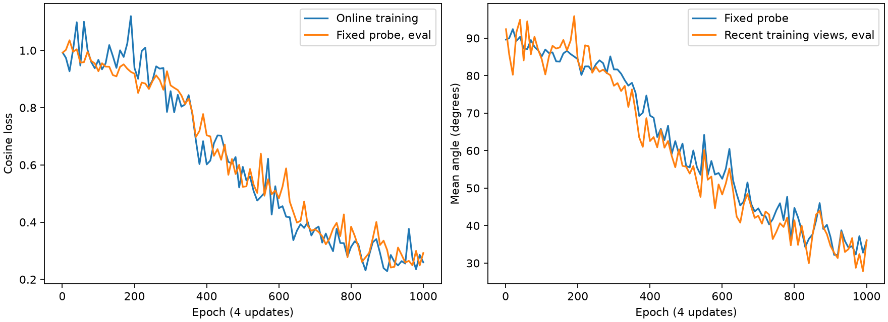

# 八零件在线 SO(3) 诊断（2026-11-09）

沿用固定旋转实验的 8 个训练零件、相同 2048 点子集、PointNet 初始化种子、batch32、恒定 lr=0.001、无 dropout / weight decay、余弦损失。关键变化是每次更新重新生成 SO(3)，每件每轮 16 个新朝向，一轮 4 次更新。原有 100 个验证零件不参与训练。

最多 1000 轮，实际 1000 轮，约 2.44 分钟。按固定 512 个同件探针旋转选择 epoch 920。选择之后生成另一组独立种子的 512 个旋转，评估一次。

| 范围 | 平均误差 | 余弦损失 | ≤3° | ≤10° |
| --- | ---: | ---: | ---: | ---: |
| 原实验 128 个固定视图，当前不参与拟合 | 34.719° | 0.28445 | 1.562% | 28.125% |
| 512 个选模探针旋转 | 32.162° | 0.24411 | 2.930% | 23.828% |
| 512 个另外保留的同件旋转 | 32.801° | 0.25407 | 4.492% | 25.586% |

此前固定训练视图可拟合到 2.143°，但同件 512 个新旋转误差为 87.169°。本轮的选模探针就是此前那组新旋转，未用于反向传播；最终旋转集合独立生成。两轮选模依据不同，不能视为严格相同选模预算的比较。

当前只改变旋转采样方式，保持固定基础点以隔离影响。它检验已见形状的朝向泛化，不检验新零件泛化，也没有证明所有几何存在唯一可识别的方向。训练 loss、近期训练视图 eval loss、探针指标以及逐件独立旋转指标都在 metrics.json；权重保存在 `runs/pointnet_random_so3_8parts_2026-11-09/best_model.pt`。

## 逐件情况与结论

| 主数据集索引 | 同件独立旋转平均误差 |
| --- | ---: |
| 69 | 78.63° |
| 147 | 13.37° |
| 232 | 46.70° |
| 546 | 11.16° |
| 644 | 31.00° |
| 659 | 29.51° |
| 790 | 6.86° |
| 843 | 45.18° |

末轮在线训练 loss 为 0.25945；同一末轮近期训练视图在 eval 模式下的 loss 为 0.29677。随机旋转训练确实降低了误差，但 1000 轮预算结束时仍未达到少样本低误差拟合目标，且曲线仍有下降和较大波动，不能宣称已充分收敛。每轮仅 4 次更新，1000 轮合计 4000 次更新，不能按 epoch 数直接与 932 件主实验比较。

同件新旋转平均误差从此前 87.17° 降到本次 32.80°，说明在线朝向覆盖有帮助；但仍不能证明换损失即可解决，或将主实验差完全归因于新零件泛化。进一步排查应聚焦训练是否能够继续拟合，以及高误差零件的几何、对称性和有向标签是否可辨识。

