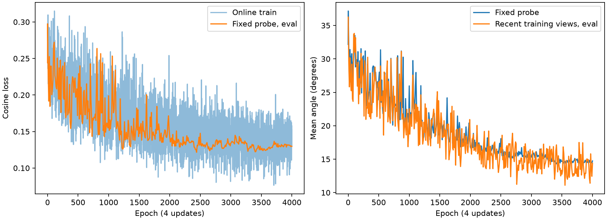

# 八零件在线 SO(3) 诊断（2026-11-09）

沿用固定旋转实验的 8 个训练零件、相同 2048 点子集、batch32、无 dropout / weight decay、余弦损失。每次更新重新生成 SO(3)，每件每轮 16 个新朝向，一轮 4 次更新。原有 100 个验证零件不参与训练。起始权重：runs/pointnet_random_so3_8parts_2026-11-09/best_model.pt；优化器重新初始化，初始 lr=0.0005，调度为 cosine，最低 lr=1e-05。

本轮最多 4000 轮，实际 4000 轮，约 8.62 分钟。按固定 512 个同件探针旋转选择本轮 epoch 3410。选择之后生成另一组独立种子的 512 个旋转，评估一次。

| 范围 | 平均误差 | 余弦损失 | ≤3° | ≤10° |
| --- | ---: | ---: | ---: | ---: |
| 原实验 128 个固定视图，当前不参与拟合 | 15.774° | 0.14406 | 40.625% | 85.156% |
| 512 个选模探针旋转 | 14.308° | 0.12273 | 38.086% | 85.547% |
| 512 个另外保留的同件旋转 | 15.164° | 0.13663 | 37.891% | 86.328% |

此前固定训练视图可拟合到 2.143°，但同件 512 个新旋转误差为 87.169°。本轮的选模探针就是此前那组新旋转，未用于反向传播；最终旋转集合独立生成。两轮选模依据不同，不能视为严格相同选模预算的比较。

本轮保持固定基础点、模型结构和旋转标签规则，在 B 最佳权重上追加训练，优化器重新初始化。它检验已见形状的朝向泛化，不检验新零件泛化，也没有证明所有几何存在唯一可识别的方向。权重保存在 `runs/pointnet_random_so3_8parts_extended_2026-11-09/best_model.pt`。W&B 停用，全程本地记录。

## 结果与逐件差异

新增 4000 轮、16000 次更新，约 8.62 分钟。按同件固定探针平均角误差选中新增第 3410 轮。每轮训练 loss 完整保存于 `metrics.json` 的 `train_history`，探针每 10 轮记录一次。

- 最低逐轮训练 loss：0.0764310（新增第 3705 轮）；它只是当轮 128 个随机朝向的均值，不能代替最终独立评测。
- 末轮训练 loss：0.1414708。
- 选定模型固定探针 loss：0.1227307，平均误差 14.308°。
- 选定模型独立同件新朝向 loss：0.1366253，平均误差 15.164°，中位 3.870°，P90 48.919°，≤3° 37.891%，≤5° 64.453%，≤10° 86.328%。

| 零件索引 | 独立新朝向平均误差 | ≤10° |
| --- | ---: | ---: |
| 69 | 94.568° | 0.000% |
| 147 | 3.667° | 100.000% |
| 232 | 5.014° | 95.312% |
| 546 | 3.165° | 100.000% |
| 644 | 4.506° | 98.438% |
| 659 | 5.370° | 96.875% |
| 790 | 2.875° | 100.000% |
| 843 | 2.148° | 100.000% |

7 个零件平均误差 2.15°～5.37°，索引 69 仍接近随机方向误差。不能据此认定其标签错误或几何有对称性；下一步应检查该件的几何与有向标签可辨识性。报告保留全部 8 个零件，未事后剔除困难样本。

对照上一轮 B：同一固定探针由 32.162° 降到 14.308°；独立评测由 32.801° 降到 15.164°。两次独立评测使用不同随机朝向种子，因此不属于逐视图配对比较。学习率、训练预算与起始权重均改变，不能单独归因为降低学习率。

当前结论：对已见形状的新朝向，7 件已经能较准确预测，但并未所有零件都低于 3°，也尚未评测新零件泛化。基础采样点仍然固定，重新采样点云的泛化尚未在本轮检验。

