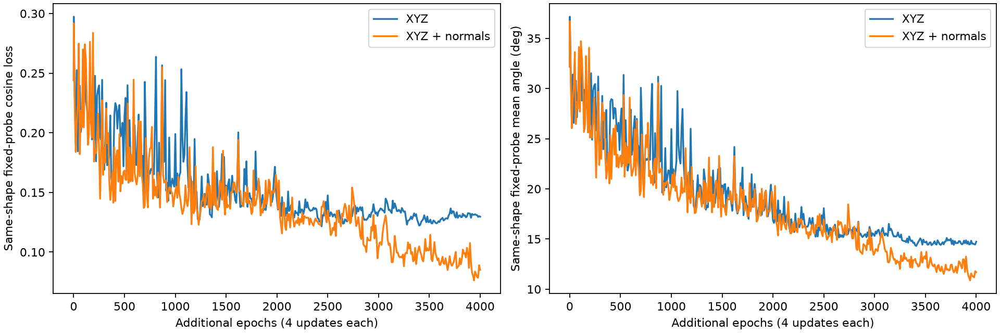

# 八零件在线 SO(3) 诊断（2026-11-09）

沿用固定旋转实验的 8 个训练零件、相同 2048 点子集、batch32、无 dropout / weight decay、余弦损失。输入通道数 6，使用法向：True。每次更新重新生成 SO(3)，每件每轮 16 个新朝向，一轮 4 次更新。原有 100 个验证零件不参与训练。起始权重：runs/pointnet_random_so3_8parts_2026-11-09/best_model.pt；优化器重新初始化，初始 lr=0.0005，调度为 cosine，最低 lr=1e-05。

本轮最多 4000 轮，实际 4000 轮，约 8.94 分钟。按固定 512 个同件探针旋转选择本轮 epoch 3940。选择之后生成另一组独立种子的 512 个旋转，评估一次。

| 范围 | 平均误差 | 余弦损失 | ≤3° | ≤10° |
| --- | ---: | ---: | ---: | ---: |
| 原实验 128 个固定视图，当前不参与拟合 | 12.559° | 0.10063 | 40.625% | 85.938% |
| 512 个选模探针旋转 | 10.872° | 0.07623 | 41.992% | 86.719% |
| 512 个另外保留的同件旋转 | 9.720° | 0.05741 | 37.109% | 86.719% |

此前固定训练视图可拟合到 2.143°，但同件 512 个新旋转误差为 87.169°。本轮的选模探针就是此前那组新旋转，未用于反向传播；最终旋转集合独立生成。两轮选模依据不同，不能视为严格相同选模预算的比较。

本轮保持固定基础点、模型结构和旋转标签规则，训练预算、学习率与起始权重见配置。它检验已见形状的朝向泛化，不检验新零件泛化，也没有证明所有几何存在唯一可识别的方向。训练 loss、近期训练视图 eval loss、探针指标以及逐件独立旋转指标都在 metrics.json；逐轮在线 loss 另存于 train_history；权重保存在 `runs/pointnet_random_so3_8parts_normals_2026-11-09/best_model.pt`。

## 与 XYZ 的配对法向对照

开始前的阶段提交为 `047544b`。本轮仍为相同 8 个零件，不加入新的训练形状，不改变 69 号的有向目标。XYZ 2048 点、训练/探针/最终旋转、B 起始 checkpoint、4000 轮预算、学习率和选模规则均与延长 B 一致。最终评测逐样本 part ID 和 target 数组已逐元素核对完全一致。

仅首层卷积由 3 通道扩展为 6 通道，原 XYZ 权重拷贝，新增法向权重置零，其他参数保持一致；程序已检查启用法向前后初始预测一致。训练期间所有参数可学习。此对照检验增加法向后微调的效果，不是 6 通道从头训练。

法向来自原 STL 最近三角面，不改变原 XYZ。8 个源 mesh 均闭合、绕序一致、有正整体体积；最大点到 mesh 表面残差见 normal_attachment_audit.json。边上的法向可能在邻接三角面间有歧义。位置和法向同乘 R.T，法向不参与平移和半径缩放。与几何对称等价监督是两回事，本轮没有使用 abs(dot)。

| 零件索引 | XYZ 平均误差 | XYZ＋法向平均误差 | 差值（负数改善） |
| --- | ---: | ---: | ---: |
| 69 | 94.568° | 50.927° | -43.642° |
| 147 | 3.667° | 3.401° | -0.267° |
| 232 | 5.014° | 4.425° | -0.589° |
| 546 | 3.165° | 3.025° | -0.139° |
| 644 | 4.506° | 4.451° | -0.055° |
| 659 | 5.370° | 6.055° | +0.685° |
| 790 | 2.875° | 2.979° | +0.104° |
| 843 | 2.148° | 2.496° | +0.348° |

总体独立朝向平均误差 15.164° → 9.720°，中位 3.870° → 3.876°，P90 48.919° → 24.618°；cosine loss 0.136625 → 0.057410。≤10° 86.328% → 86.719%。

改善主要集中在 69 号；其余 7 件的平均误差仅约 3.821° → 3.833°，不能称为全体零件普遍改善。69 号无符号轴误差仍约 46.985°，并未可靠学会环面法线。当前固定点采样、三角面法向与单种子结果也不能证明模型学到了可迁移工艺规则。

最低逐轮在线训练 loss：0.055794。最佳模型为新增 epoch 3940。总体指标见 comparison.json；所有 8 件都计入总体。单随机种子、小形状集，不能推断新零件泛化或断言法向普遍有效。

三联图：`outputs/eight_part_normals_pose_comparison/index.html`，每件取相同最终独立旋转集合的第一项，与 XYZ 三联图一一对应。标题误差是单次角误差，表格为 64 朝向平均。无 W&B，本轮记录保存在本地，且属于阶段提交之后的工作。
