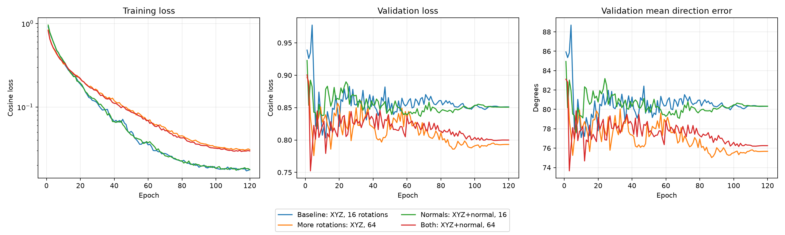

# PTv3 法向与随机朝向消融

使用相同 173/20 工程划分、配对随机旋转与点采样、同一初始化种子、相同验证输入。编码器冻结，仅训练方向 Head。16 朝向是每个零件 64 朝向的前缀子集。

| 配置 | 最佳 epoch | 验证平均角误差 | 验证中位角误差 | 30° 内 | 最佳验证余弦 loss | 训练 loss 首轮 → 末轮 |
| --- | ---: | ---: | ---: | ---: | ---: | ---: |
| no_normals_r16 | 10 | 77.09° | 74.50° | 10.00% | 0.8074 | 0.9197 → 0.0178 |
| no_normals_r64 | 87 | 75.03° | 71.47° | 13.75% | 0.7858 | 0.8381 → 0.0309 |
| with_normals_r16 | 7 | 77.66° | 73.34° | 11.88% | 0.8217 | 0.9589 → 0.0177 |
| with_normals_r64 | 3 | 73.66° | 66.46° | 11.88% | 0.7523 | 0.8217 → 0.0298 |

## 对照结果

- `no_normals_r64` 相对本次重新训练基线的平均角误差变化：-2.07°（负值为改善）。
- `with_normals_r16` 相对本次重新训练基线的平均角误差变化：+0.57°（负值为改善）。
- `with_normals_r64` 相对本次重新训练基线的平均角误差变化：-3.44°（负值为改善）。

## 解释范围

- 同一数据划分与旋转标签在四组间经过程序核验。首次实验与本次使用不同的随机流，因此请以本次重跑的 16 朝向/零法向组作基线。
- 单个随机种子、20 个验证形状；随机旋转不会增加独立形状数，不能据此声称稳定统计增益。
- 所有组均训练 120 轮、batch size 256；样本单位是一个零件的一种朝向。每轮先全局打乱训练集的零件-朝向实例，因此 batch 通常同时含多个零件和朝向，不保证按零件均衡。64 朝向组的每轮样本和梯度更新更多，结果同时包含角度覆盖和训练量效应。
- 最佳 epoch 按验证平均角误差选取；表中的验证 loss 是该 checkpoint 的 loss，并非独立按 loss 选出的最优值。
- 历史 +Z 标签、对称等价方向和零件族尚需复核。角度误差不等于打印风险或可打印率。
- 原始网格法向按三角面绕序保留；没有为本次消融修复或重建模型。

## 曲线

