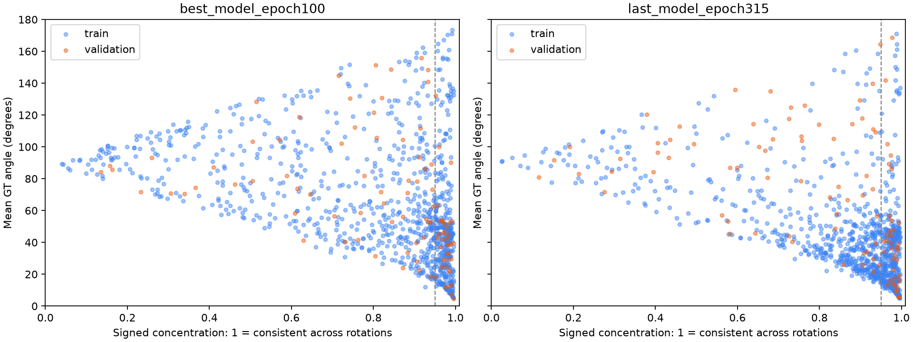

# 旋转一致性诊断（2026-11-09）

没有训练新模型或改变长训。对最佳验证权重和最近完整权重各做 1032 件×32 个固定新 SO(3) 推理，使用同一组旋转和原训练固定点子集。权重快照和逐件还原预测在 `outputs/rotation_consistency_full_2026-11-09`，SHA256 见 metrics.json。

输入按 P@R.T 旋转，预测方向按 pred@R 转回历史帧。GT 在该帧始终是 +Z。向量平均的长度（集中度）为 1 表示所有旋转预测一致，接近 0 可能是散乱、正反抵消或多峰；不能直接用集中度作正确率。额外记录轴二阶矩、正反比例、到未旋转输入预测的角差，辅助区分。

| 权重 | 范围 | 平均 GT 角误差 | 平均集中度 | 到本件共识方向平均角差 | 集中度≥0.95 的件数 |
|---|---|---:|---:|---:|---:|
| best_model_epoch100 | train | 65.03° | 0.789 | 29.07° | 335/932 |
| best_model_epoch100 | validation | 65.98° | 0.817 | 26.82° | 38/100 |
| last_model_epoch315 | train | 44.79° | 0.851 | 23.41° | 395/932 |
| last_model_epoch315 | validation | 68.50° | 0.795 | 28.24° | 38/100 |

0.95 仅是本次描述统计阈值，未调参，不用于删件、训练或宣称工艺等价。完整逐件数据在 per_part.csv；少量新旋转的误差与长训 probe 数值不必完全相同。

判读：低集中度表明预测随输入旋转明显变化，优先核查旋转建模、多模式或符号切换；高集中度但偏离 GT 表示稳定偏向另一方向，需要查看形状、GT 与工艺上下文，不能自动判断标签错了；训练件与留出件的集中度差距则提示跨形状的旋转行为差异。几何对称与工艺等价仍需另外审计。

